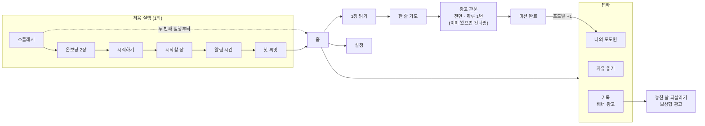

# 성경-말씀숲 개발 명세서 v1.0

2026-10-17 · 프로리

## 1. 개요

**하루 1장 읽고 한 줄 기도하면 포도나무가 자라는 성경 앱.** 이 문서는 MVP(첫 출시 버전)를 만들기 위한 개발 기준이며, AI 코딩 도구에 이 문서를 먼저 읽힌 뒤 10장의 순서대로 개발합니다. 화면 디자인 기준은 `design/screens.html`(화면 흐름 15개)입니다.

- **핵심 원칙**: 꾸준함 하나에 집중하고 기능은 최소로. 오늘의 미션은 2가지(1장 읽기 → 한 줄 기도)뿐입니다.
- **플랫폼**: 안드로이드 먼저 출시, iOS는 Mac 준비 후 같은 코드로 출시
- **로그인**: 없음. 모든 기록은 기기에 저장
- **수익**: AdMob 광고 (미션 완료 후 전면 1회/일, 놓친 날 되살리기 보상형, 기록 화면 배너)

### 브랜드 컨셉

**"열매 맺는 문화를 만들어 갑시다"** — 요한복음 15:5 "나는 포도나무요 너희는 가지라"에서 출발합니다. 읽은 날은 포도나무를 키우고, 남긴 기도는 포도알로 맺히며, 다음 업데이트의 '우리 포도원'에서 서로의 열매를 보며 격려하는 문화로 넓힙니다. 컨셉 문장은 아래 위치에 그대로 씁니다.

| 위치 | 표시 내용 |
| --- | --- |
| 01 스플래시 | 앱 이름 아래 컨셉 문장, 그 아래 "하루 1장, 열매 맺는 말씀 습관", 맨 아래 요 15:5 |
| 02 온보딩 1 | 제목 위 작은 글씨로 컨셉 문장 |
| 15 설정 › 앱 정보 | 컨셉 문장, 요 15:5, 버전 |
| 스토어 소개글 | 첫 줄에 컨셉 문장 |
| 다음 업데이트 '우리 포도원' | 함께 맺은 열매를 보여주는 화면의 제목 |

### MVP 포함

| 영역 | 포함 기능 |
| --- | --- |
| 첫 실행 | 스플래시, 온보딩 2장, 시작하기(로그인 없이), 시작할 책·장 고르기, 알림 시간 고르기, 첫 씨앗 |
| 오늘의 미션 | 홈, 1장 읽기(구절 저장, 한국어·English 전환), 한 줄 기도, 전면 광고, 미션 완료 |
| 포도원 | 매일 자라는 포도나무(100일마다 새 나무), 연속 기록, 놓친 날 되살리기 |
| 기록 | 날짜별 기도 카드, 저장한 구절, 이번 달 달력 |
| 설정 | 알림 켜기/시간, 읽는 곳 바꾸기, 성경 언어, 글자 크기, 화면 테마 |
| 자유 읽기 | 성경 탭에서 아무 책·장이나 읽기 (미션 진도와 별개) |

### MVP 제외 (다음 업데이트)

| 기능 | 이유 |
| --- | --- |
| 카카오·Google 로그인, 기록 동기화 | 서버 필요, 출시 속도 우선. iOS 출시 때는 App Store 심사 규정에 따라 Apple 로그인 등 대체 로그인 추가 여부 확인 |
| 광고 없이 쓰기(구독), 후원 | 인앱 결제 심사·구현 부담 |
| 우리 포도원(그룹), 공유 카드 | 공동체 기능은 사용자 반응 확인 후 |
| AI 묵상 도우미, 듣기(TTS), 검색 | 기능 최소화 원칙 |

### 화면 HTML에서 바뀌는 점

- 하단 탭은 **4개(홈·성경·포도원·기록)**로 줄입니다. '플랜' 탭은 진도가 홈에 보이므로 뺍니다. 설정은 홈 오른쪽 위 버튼으로 들어갑니다.
- 설정의 '광고 없이 쓰기', '포도나무 한 그루 후원', 카카오 연결은 MVP에서 숨깁니다.

## 2. 기술 스택과 프로젝트 구조

**웹 기술(React)로 만들고 Capacitor로 감싸 안드로이드·iOS 앱으로 출시합니다.** AdMob 광고와 기기 알림은 앱에서만 동작하므로, 웹(PWA) 단독 출시는 하지 않습니다.

| 영역 | 선택 | 비고 |
| --- | --- | --- |
| 빌드 | Vite + React + TypeScript | Capacitor와 궁합이 좋은 정적 빌드 |
| 스타일 | Tailwind CSS | 3장 디자인 토큰을 테마에 등록 |
| 라우팅 | react-router-dom | 화면 = 경로 1개 |
| 상태 관리 | zustand | 전역 상태 1개 + 저장소 연동 |
| 앱 감싸기 | Capacitor (@capacitor/core, android, ios) | |
| 기기 저장 | @capacitor-community/sqlite | 기기 안 SQLite DB, 웹 개발 중에는 jeep-sqlite로 같은 SQL 실행 |
| 알림 | @capacitor/local-notifications | 서버 없이 매일 반복 알림 |
| 광고 | @capacitor-community/admob | 전면·보상형·배너 |
| 기타 | @capacitor/splash-screen, status-bar, app | 스플래시, 상태바 색, 뒤로가기 |

- **앱 ID**: `kr.co.prore.malsseumsup`
- **앱 이름**: 성경-말씀숲
- **최소 지원**: 개발 시점의 Capacitor 기본 최소 버전을 따릅니다.

### 폴더 구조

```
malsseumsup/
├─ design/screens.html        # 화면 기준 (이 HTML을 그대로 따른다)
├─ public/bible/ko/GEN.json   # 개역한글, 책 1권 = 파일 1개 (66개)
├─ public/bible/en/GEN.json   # KJV, 같은 구조
├─ db/sqlite/001_init.sql     # 기기 DB 스키마 (MVP)
├─ db/supabase/001_init.sql   # 서버 DB 스키마 (다음 업데이트)
├─ src/
│  ├─ app/        App.tsx, routes.tsx, store.ts
│  ├─ screens/    Splash, Onboarding, Start, SetupBook, SetupAlarm, Seed,
│  │              Home, Read, Pray, AdGate, Done, Bible, Vineyard, Records, Settings
│  ├─ components/ TabBar, Card, Button, BottomSheet, Toast, BookPicker,
│  │              TimeWheel, VineScene, Mascot, VerseList
│  ├─ lib/        storage.ts, date.ts, bible.ts, mission.ts, growth.ts,
│  │              streak.ts, ads.ts, notify.ts
│  └─ data/       books.ts (66권 이름·코드·장 수)
├─ android/  ios/                # Capacitor가 생성
└─ CLAUDE.md                     # 이 명세서 요약 (AI가 매번 읽는 파일)
```

## 3. 디자인 토큰

**모든 색·글꼴·모서리는 아래 토큰으로만 씁니다.** 화면 코드에 색상값을 직접 쓰지 않습니다.

| 토큰 | 값 | 쓰임 |
| --- | --- | --- |
| blue | #3182F6 | 주요 버튼, 선택 상태, 진행바, 링크성 숫자("2단계 중 0 완료") |
| blue-tint | #E8F3FF | 선택 배경, 시간 휠 강조 |
| green | #36B37E | 큰 초록 배너(그라데이션 #4CC38A → #36B37E), 잎·덩굴 |
| green-light | #E5F7EE | 초록 계열 옅은 배경 |
| brand | #F5A623 | 활성 탭, 저장 책갈피, 브랜드 포인트 |
| butter | #FFF4DC | 인사 배너·안내 메시지 배경 (글자 #E8971A) |
| highlight | #FFF3C4 | 저장한 구절 형광펜 |
| gold | #FFB938 | 반짝이, 광고 표시 라벨 |
| grape / grape-light | #7C5CDB / #A58BF0 | 포도알 숫자, 단계 번호, 보상형 버튼, 포도 일러스트 |
| bg | #F4F5F7 | 앱 화면 기본 배경 (카드는 흰색) |
| cream | #FFF8EC → #FFE9B8 | 스플래시·첫 씨앗·포도원 그림 배경, 홍보 이미지 배경 |
| ink / gray | #191F28 / #8B95A1 | 본문 / 보조 글자 |
| line | #EEF0F3 | 구분선 |

| 항목 | 기준 |
| --- | --- |
| UI 글꼴 | Pretendard (400 / 600 / 700 / 800) |
| 성경 본문 글꼴 | 나눔명조 (한국어), Pretendard (English) |
| 본문 크기 | 기본 17px, 줄간격 1.75. 글자 크기 설정: 작게 15 / 보통 17 / 크게 20 |
| 모서리 | 카드 16px, 버튼 14px, 바텀시트 위쪽 24px, 칩 999px |
| 간격 | 화면 좌우 여백 16px, 카드 사이 8px |
| 그림자 | 카드: 0 1px 2px rgba(0,0,0,.03), 0 4px 14px rgba(0,0,0,.04) 한 가지만 |
| 다크 테마 | 배경 #17171C, 카드 #222228, blue #4C93FF, green #4CC38A, butter #2E2A20 (여기까지 디자인 기준). 나머지는 T10에서 글자 대비 4.5 이상이 되도록 정함: ink #F2F4F6, gray #9AA3AE, line #2E2E36, blue-tint #1D2B44, green-light #1C3A2C, highlight #4A4220, grape(글자) #A58BF0, grape-light(달력 완료 칸) #7C5CDB. 근거: `docs/contrast.md` |
| 역할 토큰 | `on-blue`(파란 배경 위 글자: 밝은 테마 #FFFFFF, 다크 #0B1A33), `grape-solid`(흰 글자가 올라가는 보라 채움 #7C5CDB), `scrim`(바텀시트 뒤 배경 rgba(30,30,25,.38)) |

- **마스코트 '알알이'**와 포도원 그림은 `design/screens.html`의 SVG(`#mascot`, `vineG()`)를 컴포넌트로 옮겨 씁니다. 새로 그리지 않습니다.

## 4. 화면 흐름

**처음 실행 때 한 번만 설정하고, 그 뒤로는 홈 → 읽기 → 기도 → 광고 → 완료를 하루 한 번 도는 구조입니다.** 광고는 미션 사이가 아닌 끝난 뒤에만 들어갑니다.



각 상자의 경로와 동작은 5장 화면 명세에 있습니다.

## 5. 화면 명세

**화면 16개, 경로 1개 = 화면 1개입니다.** 모양은 `design/screens.html`의 같은 번호 화면을 따르고, 동작은 아래 표를 따릅니다.

### 처음 들어올 때 (첫 실행 1회)

| # · 경로 | 화면 | 구성 | 동작 · 완료 조건 |
| --- | --- | --- | --- |
| 01 `/splash` | 스플래시 | 크림 배경, 알알이, 앱 이름, 컨셉 문장 "열매 맺는 문화를 만들어 갑시다", 소개 "하루 1장, 열매 맺는 말씀 습관", 요 15:5 | 1.5초 뒤 `onboarded`면 `/home`, 아니면 `/onboarding` |
| 02 `/onboarding` 1/2 | 컨셉 | 맨 위 컨셉 문장, 책+새싹 그림, "하루 1장, 말씀으로 열매 맺어요", 점 표시, 건너뛰기 | 다음 → 2/2, 건너뛰기 → `/start` |
| 03 `/onboarding` 2/2 | 미션 소개 | 미션 2가지 카드(1장 읽기, 한 줄 기도) + 점선 카드 "마음에 드는 구절은 저장(미션 아님)" | 좋아요 → `/start` |
| 04 `/start` | 시작하기 | 알알이, "가입 없이 바로 시작할 수 있어요", 버튼 1개 | MVP는 "로그인 없이 바로 시작하기"만 노출 → `/setup/book` |
| 05 `/setup/book` | 시작할 장 | 1/2 표시, 구약 39권·신약 27권 탭, 책 칩 목록, 장 번호 격자(6열), "시작할 곳: ○○ ○장" | 기본값 창세기 1장. 책을 바꾸면 장은 1로 초기화. 다음 → `/setup/alarm` |
| 06 `/setup/alarm` | 알림 시간 | 2/2 표시, 휠 3열(오전·오후 / 1~12시 / 00~55분 5분 단위), 빠른 선택 3개(아침 7:00, 점심 12:30, 밤 9:00), 미리보기 | 기본값 오전 7:00. "이대로 시작할게요" → 알림 권한 요청 → 허용이면 예약, 거부면 알림 끔. "알림 없이 시작하기" → 알림 끔. 둘 다 `/seed` |
| 07 `/seed` | 첫 씨앗 | 씨앗 심는 그림, "첫 씨앗을 심었어요!" | `onboarded = true` 저장 → `/home` |

### 오늘의 미션 (매일)

| # · 경로 | 화면 | 구성 | 동작 · 완료 조건 |
| --- | --- | --- | --- |
| 08 `/home` | 홈 | 헤더(로고, 설정 버튼), 인사 배너("N일째 열매 맺는 중"), 미션 카드(오늘 장, 0/2 진행바), 포도원 카드(포도알 수), 저장한 구절 카드(개수), 초록 배너, 미션 목록 2줄, 탭바 | 초록 배너 = 최근 저장 구절, 없으면 오늘 장 1절. 미션 상태 3가지: 시작 전 → "창세기 13장 ›" / 읽기 완료 → 기도 줄에 "하러 가기 ›" / 미션 완료 → "오늘 미션 완료! 내일은 ○○ ○장" + 포도원 보기 버튼. 어제를 놓쳤으면 인사 배너 아래 "어제를 놓쳤어요 · 되살리기 ›"(→ `/records`) |
| 09 `/read` | 1장 읽기 | 뒤로, 글자 크기 버튼, 진행바(1/2), 언어 토글(한국어·English, 복수 선택), 장 제목, 본문 스크롤, 진행 표시(n/전체 절), "다 읽었어요" | 구절을 누르면 저장/취소 토글 + 토스트("창세기 1:3 저장했어요"). 언어는 최소 1개 켜짐. "다 읽었어요"는 본문 끝까지 스크롤해야 활성. 누르면 `readAt` 저장 → `/pray` |
| 10 `/pray` | 한 줄 기도 | 진행바(2/2), 오늘 읽은 장 카드, 오늘 저장한 구절 칩, 입력란(최대 100자, 글자 수), 버튼 | 저장 구절 칩을 누르면 기도에 연결(다시 누르면 해제). 공백 제외 1자 이상이어야 버튼 활성. "기도 남기고 미션 완료" → 미션 완료 처리(7장) → `/ad` |
| 11 `/ad` | 광고 관문 | 화면 없음(광고 SDK가 띄움) | 9장 전면 광고 규칙대로 보여주거나 건너뜀 → `/done` |
| 12 `/done` | 미션 완료 | 홈 위에 어두운 배경 + 바텀시트: "오늘 미션 완료! 포도알 하나가 맺혔어요", 오늘 요약, 알알이, 오늘 자란 것 한 줄 | "나의 포도원 보기" → `/vineyard`, "홈으로" → `/home` |

### 포도원·기록·설정·자유 읽기

| # · 경로 | 화면 | 구성 | 동작 · 완료 조건 |
| --- | --- | --- | --- |
| 13 `/vineyard` | 나의 포도원 | 포도원 그림(VineScene), 단계 이름, 오늘 자란 것, 다음 변화("3일 뒤 · 꽃이 피어요"), 통계(읽은 날, 포도알, 연속 일수), 공유 버튼(숨김) | 그림은 7장 성장 계산대로. 어제를 놓쳤으면 잎이 살짝 처진 그림. 날짜 슬라이더는 HTML 시연용이며 앱에는 없음 |
| 14 `/records` | 기록 | 세그먼트(기도 / 저장한 구절), 이번 달 달력, 되살리기 카드, 카드 목록, 하단 배너 광고 | 달력: 완료한 날 = 포도, 되살린 날 = 테두리만, 놓친 날 = 빈칸, 오늘 = 금색 테두리. 기도 카드: 날짜 · 장 · 기도 · 연결 구절. 저장한 구절 카드를 길게 누르면 삭제. 되살리기 조건은 7장 |
| 15 `/settings` | 설정 | 매일 알림(토글), 알림 시간, 읽는 곳 바꾸기, 성경 언어, 글자 크기, 화면 테마(시스템·밝게·어둡게), 앱 정보 | 알림 시간·읽는 곳은 바텀시트로 06·05 화면의 휠·책 고르기를 재사용. 읽는 곳 변경은 다음 미션부터 적용(오늘 이미 읽기 시작했으면 내일부터). 앱 정보: 컨셉 문장과 요 15:5, 버전, 개인정보처리방침 링크, 번역본 저작권 표기 |
| 16 `/bible` | 자유 읽기 | 책·장 고르기 → 본문(09와 같은 본문 컴포넌트) | 미션 진도와 무관. 구절 저장은 가능 |

### 탭바

- 홈 · 성경 · 포도원 · 기록 4개. 첫 실행 화면(01~07)과 09·10·11·12에서는 숨깁니다.
- 안드로이드 뒤로가기: 09·10에서는 확인 창 없이 홈으로(읽던 위치는 저장), 탭 화면에서는 두 번 눌러 종료.

## 6. 데이터 모델과 저장

**MVP의 사용자 데이터는 기기 안 SQLite DB(`malsseumsup.db`)에 저장합니다.** 스키마는 `db/sqlite/001_init.sql`이 기준이며, 앱 시작 시 `PRAGMA user_version`을 보고 없으면 이 파일을 실행합니다. 성경 본문은 DB에 넣지 않고 앱에 포함된 JSON 파일로 읽습니다.

### 테이블 (기기 SQLite)

| 테이블 | 한 행 = | 주요 컬럼 |
| --- | --- | --- |
| app_settings | 앱 설정·진도 (항상 1행) | onboarded, alarm_enabled·hour·minute, lang_ko·en, font_size, theme, next_book·chapter, pending_book·chapter, last_interstitial_date |
| day_logs | 하루 미션 | date(키), book, chapter, read_at, prayer, linked_verse_id, completed_at, revived, revived_at |
| saved_verses | 저장한 구절 | id(예: GEN.1.3), book, chapter, verse, preview, saved_at, deleted_at |

- 날짜 키는 `YYYY-MM-DD`(기기 현지 날짜), 시각은 ISO 8601 UTC 문자열입니다.
- 모든 테이블에 `updated_at`(트리거로 자동 갱신)을 두고, 저장한 구절은 `deleted_at`으로 지웁니다(소프트 삭제). 다음 업데이트의 서버 동기화(12장)를 위한 장치입니다.
- DB가 직접 막는 규칙: 기도는 공백 제외 1~100자, 읽기와 기도 없이 완료 불가, 완료한 미션 되돌리기 불가, 되살린 날은 완료 불가, 언어는 최소 1개.
- 자주 쓰는 쿼리(오늘 미션 만들기, 읽기·미션 완료, 구절 저장·취소, 되살리기)는 SQL 파일 아래쪽 예시를 그대로 씁니다.

### 앱 코드 타입

```ts
// src/app/types.ts — DB 행을 앱에서 쓰는 모양 (0/1 → boolean으로 변환)
type BookCode = 'GEN' | 'EXO' | /* … 66권 */ 'REV';
type Ref = { book: BookCode; chapter: number };

type Settings = {
  onboarded: boolean;
  alarm: { enabled: boolean; hour: number; minute: number }; // 24시간제
  langs: { ko: boolean; en: boolean };                      // 최소 하나 true
  fontSize: 's' | 'm' | 'l';
  theme: 'system' | 'light' | 'dark';
  next: Ref;               // 다음 미션에서 읽을 장
  pendingNext?: Ref;       // 설정에서 바꾼 읽는 곳 (다음 미션부터 적용)
  lastInterstitialDate?: string;
};

type DayLog = {
  date: string;            // 'YYYY-MM-DD'
  ref: Ref;                // 그날 미션 장
  readAt?: string;
  prayer?: string;         // 1~100자
  linkedVerseId?: string;  // SavedVerse.id
  completedAt?: string;
  revived: boolean;        // 보상형 광고로 되살린 날 (읽기 없음)
  revivedAt?: string;
};

type SavedVerse = { id: string; ref: Ref; verse: number; preview: string; savedAt: string };
```

### 계산해서 쓰는 값 (저장하지 않음)

| 값 | 계산 | 어디서 |
| --- | --- | --- |
| 완료한 날 수 · 포도알 수 | `completed_at`이 있는 day_logs 수 (되살린 날 제외) | 뷰 `v_stats` |
| 포도원 성장일 | 완료한 날 수 + 1 (첫 씨앗 = 1일) | 뷰 `v_stats` |
| 저장한 구절 수 | `deleted_at`이 없는 saved_verses 수 | 뷰 `v_stats` |
| 기록 달력 · 기도 카드 | 날짜별 상태 / 완료한 날의 기도와 연결 구절 | 뷰 `v_calendar`, `v_prayer_cards` |
| 연속 일수 | 7장 연속 기록 규칙 (날짜 계산이라 코드에서) | `streak.ts` |

### 성경 JSON 구조

책 1권 = 파일 1개로 나눠, 읽을 책만 불러옵니다.

```json
// public/bible/ko/GEN.json
{ "code": "GEN", "name": "창세기", "chapters": [
  ["태초에 하나님이 천지를 창조하시니라", "땅이 혼돈하고 …"],
  ["천지와 만물이 다 이루니라", "…"]
] }
```

- `chapters[장-1][절-1]` = 본문 문자열. 영어(`public/bible/en/`)도 같은 구조입니다.
- `src/data/books.ts`에 66권 `{ code, ko, en, chapters, testament }` 목록을 둡니다. 코드는 표준 약어(GEN, EXO … MAT, MRK … REV)를 씁니다.
- 앱 시작 시 두 파일의 장·절 수가 `books.ts`와 맞는지 개발 모드에서 검사합니다.

## 7. 핵심 로직

**하루 미션 1번, 완료하면 포도알 1개와 성장 하루.** 아래 규칙은 `src/lib/`의 각 파일에 순수 함수로 만들고, 화면은 그 결과만 보여줍니다.

### 7.1 날짜 기준 (`date.ts`)

1. 하루의 기준은 **기기 현지 날짜**이며 자정(00:00)에 바뀝니다. 키 형식은 `YYYY-MM-DD`.
2. 미션은 **읽기를 시작한 날짜**에 기록됩니다. 23:50에 읽기 시작해 00:10에 기도를 남겨도 전날 미션으로 완료됩니다.

### 7.2 미션 (`mission.ts`)

1. `/read`에 들어갈 때 오늘 `DayLog`가 없으면 만듭니다. 이때 `pendingNext`가 있으면 먼저 `next`에 반영하고 지운 뒤, `ref = progress.next`로 정합니다.
2. 읽기 완료: 본문 마지막 절이 화면에 보인 뒤 "다 읽었어요"를 누르면 `readAt` 기록.
3. 미션 완료: `readAt`이 있고 기도가 공백 제외 1~100자일 때 `prayer`, `completedAt` 기록.
4. 완료 직후 `progress.next`를 다음 장으로 옮깁니다. 책의 마지막 장이면 다음 책 1장, 요한계시록 22장 다음은 창세기 1장.
5. 하루에 미션은 1번만 완료됩니다. 완료 후 홈의 미션 버튼은 "오늘 미션 완료"로 바뀌고, 더 읽고 싶으면 성경 탭(자유 읽기)을 씁니다.

### 7.3 연속 기록과 놓친 날 (`streak.ts`)

1. **채워진 날** = `completedAt`이 있거나 `revived`인 날.
2. **연속 일수** = 오늘(채워졌으면) 또는 어제부터 거꾸로 세어 끊기지 않은 채워진 날의 수. 홈 인사 배너에 "N일째 열매 맺는 중"으로 표시하고, 0이면 "오늘 첫 열매를 맺어 볼까요?".
3. **어제를 놓친 상태** = 어제가 채워지지 않았고, 그 전에 채워진 날이 하나 이상 있음. 이때 포도원 잎이 살짝 처지고(사라지거나 죽지 않음), 오늘 미션을 완료하면 바로 회복됩니다.

### 7.4 놓친 날 되살리기 (보상형 광고)

1. 가능 조건: 어제를 놓쳤고, 그제는 채워져 있고, 최근 7일 안에 되살리기를 쓴 적이 없음. 오늘 자정까지만 가능.
2. 보상형 광고를 끝까지 보면(보상 지급 콜백) 어제 `DayLog`를 `revived: true`로 만들고 `revived_at`에 지금 시각을 기록합니다.
3. 되살린 날은 **연속 기록만 이어 주고**, 포도알·성장일은 늘리지 않습니다.

### 7.5 포도원 성장 (`growth.ts`)

**성장일 = 완료한 날 수 + 1** (첫 씨앗 화면이 1일, 첫 미션을 마치면 2일). 그림은 `design/screens.html`의 `vineG(d)` · `scene(d)`를 그대로 옮기고, 문구는 `todayMsg(d)` · `nextMsg(d)`를 옮깁니다.

| 성장일 | 단계 | 이정표 문구 |
| --- | --- | --- |
| 1 | 씨앗 | 흙 속에 씨앗을 심어요 |
| 2 | 싹 틈 | 흙을 뚫고 작은 싹이 올라와요 |
| 3 | 떡잎 | 떡잎 두 장이 펴져요 |
| 5 | 본잎 | 첫 포도잎이 나와요 |
| 7 | 어린 줄기 | 줄기가 쭉 자라요 · 1주 축하 |
| 10 | 덩굴손 | 덩굴손이 나와 지지대를 찾아요 |
| 14 | 지지대 타기 | 지지대를 감고 올라가요 · 2주 축하 |
| 21 | 가지 뻗기 | 양옆으로 가지가 퍼져요 |
| 30 | 꽃 | 작은 포도꽃이 피어요 · 한 달 축하 |
| 40 | 초록 송이 | 덜 익은 초록 송이가 맺혀요 |
| 50 | 익어 가는 송이 | 송이가 보라색으로 물들기 시작해요 |
| 70 | 굵어지는 송이 | 포도알이 굵어지고 진해져요 |
| 100 | 포도나무 | 송이가 주렁주렁 · 100일 축하 |
| 101~ | 포도원 | 100일마다 새 나무가 씨앗부터 다시 자라요 (최대 3그루까지 한 화면, 그 이상은 숫자로) |

이정표가 없는 날에도 매일 하나씩 자랍니다.

| 성장일 구간 | 매일 바뀌는 것 |
| --- | --- |
| 2~13 | 줄기가 위로 자라고 잎이 한 장씩 늘어남, 10일부터 덩굴손 추가 |
| 14~20 | 왼쪽 가지가 지지대를 따라 뻗음 |
| 21~29 | 오른쪽 가지가 뻗고 잎이 한 장씩 늘어남 |
| 30~39 | 꽃이 하나씩 더 핌 |
| 40~49 | 송이가 커지고 5일마다 새 송이 |
| 50~99 | 송이가 초록 → 분홍 → 보라로 하루씩 익고 5일마다 새 송이 |

- 미션 완료 바텀시트(12)와 포도원 화면(13)의 "오늘 자란 것"은 `todayMsg(성장일)`, "다음 변화"는 `nextMsg(성장일)`을 씁니다.
- 이정표 날에는 완료 바텀시트에 반짝이 연출을 추가합니다.

## 8. 알림 명세 (`notify.ts`)

**하루 1번, 사용자가 고른 시간에, 오늘 미션을 아직 안 했을 때만 보냅니다.** 서버 없이 기기 안 알림(@capacitor/local-notifications)으로 처리합니다.

1. **예약 방식**: 반복 알림 1개 대신, 앞으로 7일치 알림을 하루 1개씩 예약합니다. 앱을 열 때, 미션을 완료할 때, 알림 설정을 바꿀 때마다 전부 지우고 다시 예약합니다.
2. **오늘 건너뛰기**: 다시 예약할 때 오늘 미션이 이미 완료됐으면 오늘 알림은 빼고 내일부터 예약합니다.
3. **권한**: 06 화면 "이대로 시작할게요"에서 요청합니다(안드로이드 13 이상은 알림 권한 필요). 거부하면 알림을 끄고, 설정에서 다시 켤 때 권한을 다시 요청하며, 시스템에서 막혀 있으면 기기 설정으로 안내합니다.
4. **누르면**: 앱을 열어 `/home`으로 갑니다.
5. **문구**: 아래 중 상황에 맞는 것 1개. 제목은 항상 "성경-말씀숲".

| 상황 | 문구 |
| --- | --- |
| 기본 (번갈아 사용) | "오늘의 1장이 기다리고 있어요 · {책} {장}장" / "알알이가 물을 기다려요. 오늘 1장 읽어 볼까요?" |
| 오늘 완료하면 이정표 | "오늘 1장을 읽으면 {이정표 문구}" (예: 꽃이 피어요) |
| 어제를 놓침 | "어제는 쉬었어요. 오늘 다시 함께 시작해요" |

- 놓친 날 문구는 죄책감을 주지 않는 말투로만 씁니다. 알림은 하루 1개를 넘지 않습니다.

## 9. 광고 명세 (`ads.ts`)

**광고는 읽기·기도 중간에는 절대 나오지 않고, 미션이 끝난 쉼표에서만 하루 1번 나옵니다.** AdMob 정책상 행동마다 띄우는 전면 광고와 작업 도중 갑자기 뜨는 광고는 금지이므로 이 규칙을 바꾸지 않습니다([AdMob 정책](https://support.google.com/admob/answer/6201362?hl=en)).

| 종류 | 위치 | 빈도 · 조건 | 실패 시 |
| --- | --- | --- | --- |
| 전면 | 11 `/ad` (기도 저장 직후, 완료 바텀시트 전) | 하루 최대 1번 (`app_settings.last_interstitial_date`이 오늘이면 건너뜀) | 3초 안에 준비 안 되면 건너뛰고 `/done` |
| 보상형 | 14 기록 화면 "되살리기" | 7.4 조건을 만족할 때만 버튼 노출, 주 1회 | "지금은 광고를 불러올 수 없어요" 토스트, 되살리기 안 함 |
| 배너 | 14 기록 화면 하단 (탭바 위) | 기록 화면에 있을 때만 | 자리만 비움 (빈 공간 없이 접힘) |

1. **미리 불러오기**: 전면 광고는 `/pray`에 들어갈 때 미리 불러와 두어, 기도 저장 직후 지연 없이 보여줍니다.
2. **테스트 광고**: 개발·내부 테스트 중에는 반드시 AdMob 공식 테스트 광고 ID를 쓰고, 출시 빌드에서만 실제 광고 단위 ID로 바꿉니다. 광고 단위 ID는 코드에 직접 쓰지 않고 환경 설정 파일에 둡니다. 실제 광고를 직접 누르면 계정이 정지될 수 있습니다.
3. **광고 콘텐츠**: AdMob에서 광고 콘텐츠 등급을 가장 낮게(전체 이용가) 설정하고, 도박·데이트·주류 등 민감한 카테고리를 차단합니다.
4. **동의·추적**: iOS는 첫 광고 전에 앱 추적 투명성(ATT) 안내를 띄웁니다. 배포 국가에 유럽·영국이 포함되면 Google 동의 화면(UMP)을 붙입니다.
5. **웹 개발 모드**: 브라우저에서는 광고 SDK 대신 "광고 자리" 화면을 1초 보여주고 넘어가서 흐름을 시험할 수 있게 합니다.
6. **app-ads.txt**: 스토어에 등록한 개발자 웹사이트(prore.co.kr) 루트에 AdMob이 안내하는 app-ads.txt를 올립니다.

## 10. 개발 순서

**작업 14개를 순서대로, 한 번에 하나씩 AI에게 요청하고 완료 기준을 직접 확인한 뒤 Git에 커밋합니다.** 1~2일차는 브라우저에서 앱을 완성하고, 3~4일차에 안드로이드 앱으로 만들어 알림·광고를 붙입니다.

### 1일차 — 뼈대와 읽기

1. **준비 (T0)**: 프로젝트 폴더에 `design/screens.html`과 이 명세서(`docs/spec.md`)를 넣습니다. (시작 키트에는 이미 들어 있고, `CLAUDE.md`도 포함돼 있습니다.)
   - 프롬프트: "CLAUDE.md와 docs/spec.md를 읽고 빠진 핵심 규칙이 있으면 CLAUDE.md에 보태줘."
   - 완료 기준: CLAUDE.md에 미션 규칙, 디자인 토큰, 폴더 구조, 광고 규칙이 들어 있음
2. **프로젝트 생성 (T1)**: "spec.md 2·3장대로 Vite + React + TypeScript + Tailwind 프로젝트를 만들고, 디자인 토큰을 테마에 등록하고, 5장의 경로 16개를 빈 화면으로 만들고, 탭바(홈·성경·포도원·기록)를 붙여줘."
   - 완료 기준: 모든 경로가 열리고 탭 이동이 됨
3. **저장과 규칙 (T2)**: "spec.md 6·7장과 db/sqlite/001_init.sql대로 SQLite 연결·마이그레이션(storage.ts), store.ts, date.ts, mission.ts, streak.ts, growth.ts를 만들고 7장 규칙마다 단위 테스트를 써줘."
   - 완료 기준: 테스트 통과 (자정 넘김, 마지막 장 다음 책, 되살리기 조건, 성장일 계산 포함)
4. **성경 데이터 (T3)**: 개역한글·KJV JSON을 6장 구조로 66개씩 나눠 넣고, "books.ts와 bible.ts를 만들고 장·절 수 검사를 붙여줘."
   - 완료 기준: 창세기 1장, 시편 119편, 요한계시록 22장이 정상 표시
5. **첫 실행 (T4)**: "screens.html 01~07 화면을 spec.md 5장대로 만들어줘. 책·장 고르기와 시간 휠 동작도 그대로."
   - 완료 기준: 처음 켜면 온보딩부터, 다시 켜면 홈부터 시작
6. **홈과 읽기 (T5·T6)**: "08 홈과 09 읽기 화면을 만들어줘. 구절 저장, 언어 전환, 끝까지 읽어야 켜지는 버튼까지."
   - 완료 기준: 홈 미션 상태 3가지가 바뀌어 보임, 구절 저장 토스트가 뜸

### 2일차 — 기도·포도원·기록·설정

7. **기도와 완료 (T7)**: "10 기도, 11 광고 관문(웹은 1초 모의 화면), 12 완료 바텀시트를 만들고 미션 완료 처리와 다음 장 이동을 연결해줘."
   - 완료 기준: 미션 완료 후 포도알 +1, 내일 장이 다음 장으로 바뀜
8. **포도원 (T8)**: "screens.html의 vineG, scene, todayMsg, nextMsg를 VineScene 컴포넌트와 growth.ts로 옮겨 13 화면을 만들어줘. 어제를 놓쳤으면 잎이 처진 그림."
   - 완료 기준: 개발용으로 성장일을 바꿔 보면 HTML과 같은 그림이 나옴
9. **기록 (T9)**: "14 기록 화면(달력, 기도 카드, 저장한 구절, 되살리기 카드, 배너 자리)을 만들어줘. 되살리기는 웹에서 모의로."
   - 완료 기준: 7.4 조건일 때만 되살리기 카드가 보임
10. **설정과 자유 읽기 (T10)**: "15 설정과 16 자유 읽기를 만들고 다크 테마를 적용해줘."
    - 완료 기준: 읽는 곳을 바꾸면 다음 미션부터 적용됨

### 3~4일차 — 앱으로 만들기

11. **안드로이드 앱 (T11)**: "Capacitor로 안드로이드 앱을 만들어줘. 앱 ID kr.co.prore.malsseumsup, SQLite DB가 안드로이드에서도 그대로 동작하게 하고 스플래시·상태바·뒤로가기를 spec.md대로."
    - 완료 기준: 내 폰에 설치되고 껐다 켜도 기록이 남음
12. **알림 (T12)**: "spec.md 8장대로 알림을 붙여줘."
    - 완료 기준: 2분 뒤로 시간을 맞추면 알림이 오고, 미션을 끝낸 날은 오지 않음
13. **광고 (T13)**: "spec.md 9장대로 AdMob 전면·보상형·배너를 테스트 광고 ID로 붙여줘."
    - 완료 기준: 전면 광고가 하루 1번만, 보상형은 끝까지 봐야 되살아남

### 5일차~ — 다듬고 출시

14. **테스트와 출시 (T14)**: 11장 체크리스트를 모두 통과시키고, Google Play 내부 테스트로 지인 몇 명에게 먼저 배포한 뒤 실제 광고 ID로 바꿔 심사를 받습니다.

> 작업 요령: 매 작업 프롬프트 앞에 "CLAUDE.md와 spec.md를 먼저 확인해"를 붙입니다. 에러가 나면 메시지를 그대로 붙여 넣고, 잘 되면 바로 커밋합니다.

## 11. 테스트·출시 체크리스트와 열린 질문

**출시 전에 아래 항목을 실제 안드로이드 폰에서 모두 확인합니다.**

### 기능 테스트

- [ ] 첫 실행: 온보딩 → 시작할 장 → 알림 → 첫 씨앗 → 홈. 두 번째 실행은 바로 홈
- [ ] 시작할 장을 시편 23편으로 고르면 첫 미션이 시편 23편
- [ ] 미션: 끝까지 읽기 전에는 "다 읽었어요"가 꺼져 있음, 기도가 비어 있으면 완료 불가
- [ ] 미션 완료 → 전면 광고(하루 첫 완료만) → 완료 시트 → 포도알 +1, 성장일 +1
- [ ] 같은 날 두 번째 미션 불가, 자유 읽기는 가능
- [ ] 23:50에 읽기 시작해 00:10에 완료 → 전날 미션으로 기록
- [ ] 요한계시록 22장 완료 → 다음 미션 창세기 1장
- [ ] 하루 놓침 → 잎이 처지고 되살리기 카드 노출 → 보상형 광고 완료 시 연속 기록 유지, 포도알은 그대로
- [ ] 이틀 놓침 → 되살리기 카드 없음, 연속 기록 0부터
- [ ] 구절 저장/취소, 기록 탭에서 길게 눌러 삭제
- [ ] 한국어·English 동시 표시, 둘 다 끄기 불가
- [ ] 글자 크기 3단계, 다크 테마
- [ ] 앱 삭제 전까지 껐다 켜도, 폰을 재부팅해도 기록 유지

### 알림·광고 테스트

- [ ] 설정한 시간에 알림 1개, 미션 끝낸 날은 알림 없음
- [ ] 알림 권한 거부 후 설정에서 다시 켜기
- [ ] 비행기 모드에서 미션 완료 가능(광고는 건너뜀)
- [ ] 테스트 광고 ID로만 동작 확인, 출시 빌드에서만 실제 ID

### 출시 준비

- [ ] 개역한글·KJV 사용 범위 확인 (대한성서공회 문의), 앱 정보에 번역본 저작권 표기
- [ ] 개인정보처리방침 페이지 (기기 저장, AdMob 광고 식별자 사용 명시) 링크
- [ ] prore.co.kr에 app-ads.txt 업로드
- [ ] 스토어 등록 정보: 앱 이름, 짧은 설명(첫 줄에 컨셉 문장), 스크린샷(`design/promo.html` 활용), 아이콘, 콘텐츠 등급 설문, 데이터 보안 설문(광고 ID 수집)
- [ ] Google Play 내부 테스트 → 피드백 반영 → 프로덕션 심사 제출

### 열린 질문

- 개역한글을 앱에 넣을 때 표기·사용 조건이 따로 있는지 (대한성서공회 답변에 따라 심사 제출 전에 확정)
- iOS 출시 시점 (Mac·Apple 개발자 계정 준비 후)
- 다음 업데이트 순서: 광고 없이 쓰기(구독), 로그인·동기화, 우리 포도원(그룹) 중 무엇을 먼저 할지

## 12. 서버 DB와 동기화 (다음 업데이트)

**카카오·Google 로그인을 붙이는 다음 업데이트에서, 기기 SQLite는 그대로 두고 Supabase(PostgreSQL)에 같은 구조로 복사해 동기화합니다.** 로그인하지 않은 사용자는 지금처럼 기기에만 저장됩니다. 서버 스키마는 `db/supabase/001_init.sql`이 기준이며, Supabase 대시보드의 SQL Editor에서 한 번 실행합니다.

### 테이블 (Supabase)

| 테이블 | 내용 | 기기 테이블과의 관계 |
| --- | --- | --- |
| profiles | 닉네임 (가입하면 자동 생성) | 서버 전용 |
| user_settings | 언어·글자 크기·테마·진도 | app_settings에서 알림·광고 칸을 뺀 것 |
| day_logs | 하루 미션 (user_id + date가 키) | day_logs와 같은 컬럼 |
| saved_verses | 저장한 구절 (user_id + verse_id가 키) | saved_verses와 같은 컬럼 (id → verse_id) |
| vineyards | 우리 포도원 (이름, 6자리 초대 코드, 만든 사람) | 서버 전용 |
| vineyard_members | 포도원 멤버 (owner / member) | 서버 전용 |
| shared_fruits | 함께 맺은 열매 (미션 완료 후 '나누기'를 고른 날만, 기도 공개는 선택) | 서버 전용 |
| fruit_cheers | 열매에 보내는 '아멘' 응원 | 서버 전용 |

### 보안 (RLS)

- 모든 테이블에 행 단위 보안(RLS)을 켭니다. 내 기록·설정·저장 구절은 나만 읽고 씁니다.
- 포도원과 함께 맺은 열매는 같은 포도원 멤버만 봅니다. 가입은 초대 코드 함수 `join_vineyard`로만, 만들기는 `create_vineyard`로 합니다.
- 기도는 기본 비공개입니다. 나누기를 고를 때 기도 공개 여부를 따로 묻습니다.

### 동기화 규칙

1. **처음 로그인**: 기기의 day_logs·saved_verses·설정을 서버에 모두 올립니다(upsert). 서버에 이미 기록이 있으면(다른 폰에서 쓰던 계정) 아래 병합 규칙으로 합칩니다.
2. **언제**: 앱을 열 때, 미션을 완료할 때, 구절을 저장·취소할 때. 오프라인이면 기기에만 쓰고 다음 기회에 올립니다.
3. **무엇을**: 마지막 동기화(`app_settings.last_synced_at`) 이후 `updated_at`이 바뀐 행만 주고받습니다.
4. **병합**: 같은 날짜·같은 구절이면 `updated_at`이 늦은 쪽이 이깁니다. 단, `completed_at`은 한쪽에라도 있으면 유지하고(완료는 되돌리지 않음), 지운 구절은 `deleted_at`으로 전달합니다.
5. **알림 시간**은 기기마다 따로 두고 동기화하지 않습니다.

### 계정 삭제

- 로그인을 넣으면 Google Play 정책상 앱 안에서 계정과 데이터를 지울 수 있어야 합니다. 설정 › 계정 삭제에서 `delete_my_account` 함수를 부르면 서버 데이터가 모두 함께 지워집니다.
- 열린 질문: 포도원을 만든 사람이 계정을 지우면 지금은 포도원도 함께 지워집니다. 다른 멤버에게 넘길지 정해야 합니다.
